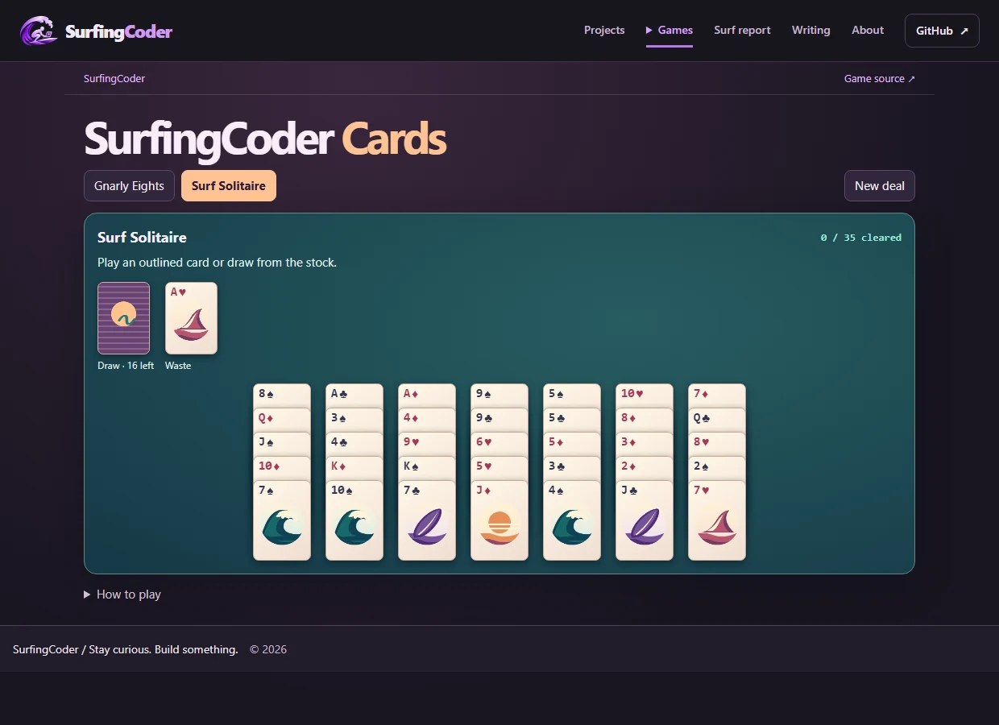

# SurfingCoder Cards

Play Golf Solitaire solo or face the computer in Crazy Eights. Both games use a surf-themed card table. In Crazy Eights, two long-haired surfer Jokers join the eights as wild cards.

[Play SurfingCoder Cards](https://surfingcoder.com/cards/)

## Rules

- **Golf Solitaire.** Clear the seven columns by playing an exposed card one rank away from the waste card. Aces and kings do not wrap. Draw from the stock when you need a new waste card.
- **Crazy Eights.** Match the current suit or top rank, or play a wild card and choose the next suit. Draw once when you cannot play. The discard pile is recycled when needed. If neither player can play or draw, the smaller hand wins.

## Run locally

From this directory, start a static server with `python -m http.server 8000 --bind 127.0.0.1` and visit [localhost:8000](http://127.0.0.1:8000/). Run `node --test rules.test.mjs` to check the game rules.
